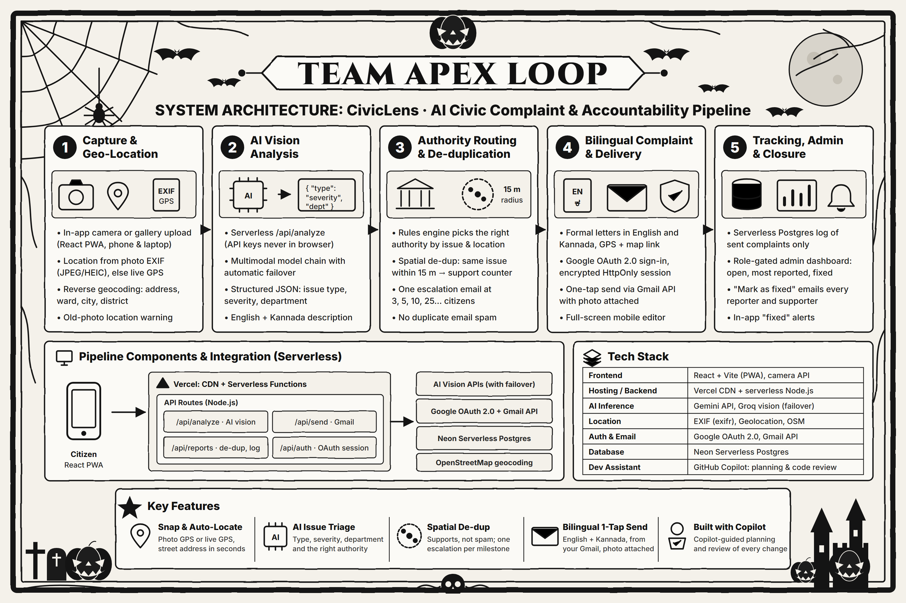

<div align="center">

# CivicLens

### Complaining is hard. We made it easy.

**Snap a photo of a civic problem. AI identifies it, finds the exact location, picks the right government office, drafts a formal complaint in English and Kannada, and sends it from your own Gmail with the photo attached.**

[Architecture](#architecture) · [Tech stack](#tech-stack) · [How Copilot helped](#how-github-copilot-helped-us)

Built by **Team Apex Loop** for Hacktoberfest VVCE 2026 · Track 2, Challenge B: **Best Hack Built with GitHub Copilot**

</div>

---

## The problem

Potholes, broken streetlights, overflowing garbage bins and water leaks stay unfixed for weeks, mostly because nobody reports them properly. People don't know which authority is responsible, writing a formal complaint takes effort, and many people are more comfortable in Kannada than in English.

The problem doesn't end once a complaint is filed, either:

- **Duplicate spam.** When 50 people report the same pothole, the department gets 50 emails, which get ignored or filtered.
- **No closure.** Citizens rarely hear back when something is fixed.

## What CivicLens does

| Step | What happens |
|---|---|
| 1. **Snap** | Take a photo with the in-app camera, or upload one from the gallery. |
| 2. **Locate** | Uses the GPS saved in the photo (EXIF, JPEG and HEIC), otherwise the phone's live GPS, then turns it into a street address. If an old gallery photo has no location, the app warns you instead of guessing. |
| 3. **Analyse** | An AI vision model identifies the issue type, severity and responsible department, and writes a short description in English and Kannada. |
| 4. **Route** | A rules engine picks the responsible government authority based on the type of problem and where it is. |
| 5. **De-duplicate** | If the same kind of problem was already reported within about 15 m and isn't fixed yet, no new email is sent. The citizen adds their support instead, and the authority gets **one escalation email** at 3, 5, 10, 25… reports. |
| 6. **Send** | A formal bilingual letter (English and Kannada) with the address, GPS coordinates and a map link is sent from the citizen's own Gmail, with the photo attached, in one tap. |
| 7. **Close the loop** | An admin dashboard lists every sent complaint. Marking one as fixed emails everyone who reported or supported it, and their app shows "Fixed 🎉". |

### Features

- 📸 **In-app camera** that works on phones and laptops, plus gallery upload
- 📍 **Accurate location**: photo EXIF GPS, then live GPS, then reverse geocoding, with a warning for stale photos
- 🤖 **AI triage**: issue type, severity, department and a bilingual description, with automatic failover between AI providers
- 🏛️ **Authority routing**: picks the responsible government authority from the problem type and location
- 🧭 **Spatial de-duplication** with a support counter and milestone escalations, so departments aren't spammed
- ✉️ **One-tap Gmail sending** with the photo attached, through Google sign-in (OAuth 2.0)
- 🗣️ **Bilingual letters**: formal English and Kannada, editable in a full-screen mobile editor
- 🛡️ **Admin dashboard** (role-gated): open, most reported and fixed complaints, with mark-as-fixed notifications
- 🔒 **Privacy by design**: drafts never leave the phone, users never see each other's reports, and API keys stay on the server

## Architecture



```
Citizen (React web app, mobile-first)
   │  photo + GPS
   ▼
Vercel CDN + serverless functions (Node.js)
   ├── /api/analyze   → AI vision models (Gemini, with Groq as failover)
   ├── /api/send      → Gmail API (sends from the citizen's own account)
   ├── /api/reports   → spatial de-duplication, support counter, status sync
   ├── /api/admin     → admin dashboard, mark as fixed, notify reporters
   └── /api/auth      → Google OAuth 2.0, encrypted HttpOnly session cookie
          │
          ├── Neon serverless Postgres (sent complaints, supports)
          └── OpenStreetMap Nominatim (reverse geocoding)
```

- **Serverless**: there's no server to manage. Each API route runs on demand on Vercel, scales automatically and costs nothing when idle.
- **API keys stay server-side**: the browser only calls our own `/api/*` routes, so no AI key is ever bundled into the page.
- **Stateless sign-in**: the Google refresh token is encrypted with AES-256-GCM inside an HttpOnly cookie, so no session database is needed.

## Tech stack

| Layer | Technology |
|---|---|
| Frontend | React + Vite (mobile-first web app), MediaDevices camera API |
| Backend | Vercel serverless functions (Node.js) |
| AI | Google Gemini API, Groq vision model as failover |
| Location | `exifr` (photo EXIF GPS), Geolocation API, OpenStreetMap Nominatim |
| Auth & email | Google OAuth 2.0, Gmail API |
| Database | Neon serverless Postgres |
| Dev assistant | **GitHub Copilot** (Copilot Chat in VS Code) |

## How GitHub Copilot helped us

- **Feature planning:** Explored implementation approaches for our civic complaint reporting workflow.
- **AI integration:** Investigated ways to connect vision models for identifying civic issues from photos.
- **Location handling:** Explored GPS extraction, geolocation and reverse geocoding approaches.
- **Complaint routing:** Reviewed logic for matching civic issues with the appropriate government authorities.
- **Code review:** Used AI-assisted review to examine potential bugs, edge cases and security concerns.
- **Documentation:** Improved project setup instructions, architecture documentation and feature explanations.

## Project structure

```
api/                 Vercel function entry points (one file per route)
server/
  analyze.js         AI prompt and model failover chain
  auth.js            Google OAuth sign-in, token refresh
  session.js         AES-GCM encrypted session cookie, admin check
  gmail.js           Gmail API sending (MIME with photo attachment)
  reports.js         spatial de-dup, support counter, escalation, admin actions
  db.js              Postgres schema
  http.js, routes.js shared request handling for Vercel and the dev server
src/
  screens/           Landing, Report, Complaint, My Reports, Hotspots, Admin
  components/        camera, account menu, icons, badges
  lib/
    location.js      EXIF GPS, live GPS, reverse geocoding
    authorities.js   which office handles which problem, where
    letters.js       English and Kannada complaint and escalation templates
docs/                architecture diagrams
```

## Roadmap

- **Proof of fix**: require an "after" photo at the same GPS spot before a complaint can be closed, and let reporters confirm the fix
- **Repeat-failure detection**: flag spots that break again soon after being "fixed"
- **Automatic escalation and RTI drafts** when a complaint isn't resolved in time
- **Official grievance portal integration** (Karnataka iPGRS)

## Team Apex Loop

- **Harish H**
- **Nithya**

## License

Released under the [MIT License](LICENSE).
